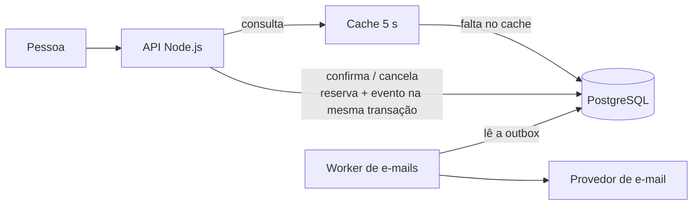
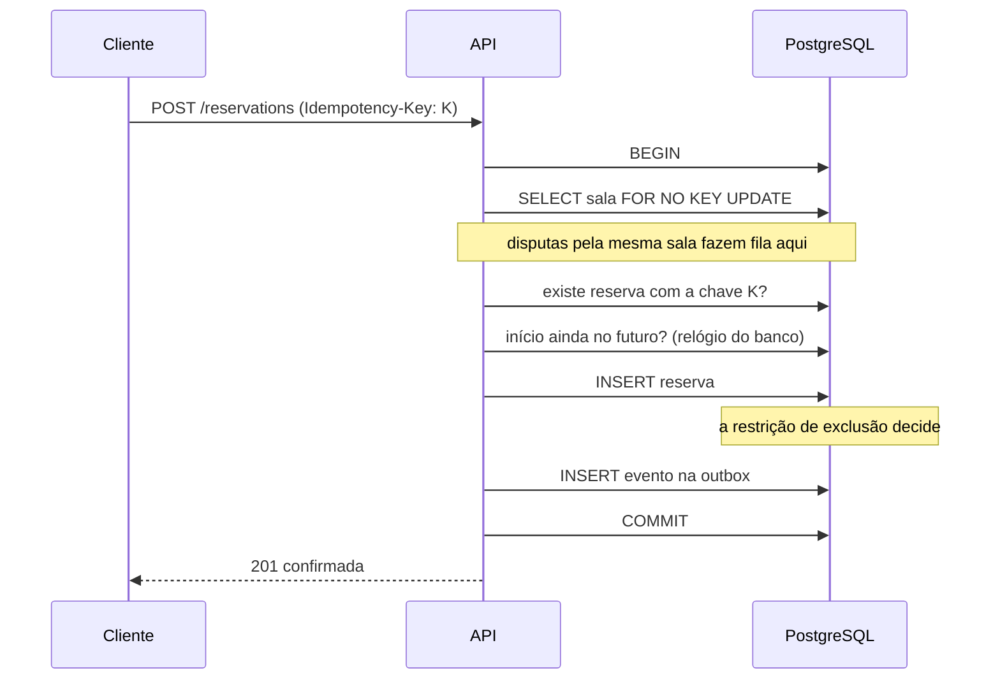
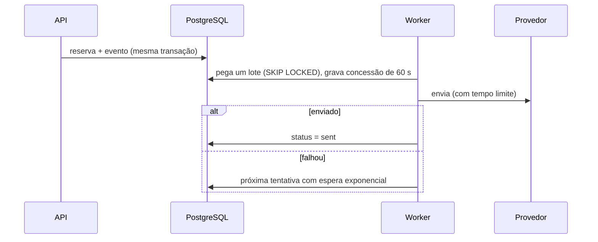

# Arquitetura do sistema de reserva de salas

## Resumo

O banco de dados decide quem fica com o horário. Uma restrição de exclusão no PostgreSQL torna impossível gravar duas reservas confirmadas sobrepostas na mesma sala, sem depender de o código da aplicação estar certo.

As demais decisões partem do que o enunciado permite relaxar e do que ele não permite:

| Requisito | Decisão |
| --- | --- |
| Nunca duas reservas no mesmo intervalo | Restrição `EXCLUDE` no PostgreSQL |
| A confirmação valida o horário no momento em que acontece | Escrita sempre no banco principal, nunca no cache |
| Consultas muito mais frequentes, com alguns segundos de atraso aceitáveis | Cache de 5 s por sala e dia |
| A pessoa precisa saber se reservou | Sucesso só após o `COMMIT`, respostas com desfecho explícito e `Idempotency-Key` |
| E-mail fora do ar não pode impedir reservas | Outbox transacional e worker separado |



## Dimensionamento

São **estimativas minhas**, já que o enunciado só informa 2 mil salas e 50 mil pessoas:

- **Confirmações:** 50 mil pessoas × 2 reservas por dia = 100 mil por dia, cerca de 1,2 por segundo em média. Com pico de 10×, cerca de 12 por segundo.
- **Consultas:** 10% das pessoas conectadas no pico, atualizando a agenda a cada 5 s, cerca de 1.000 por segundo.

Esse volume cabe em um único PostgreSQL. A dificuldade do problema é a **correção sob concorrência**, não a escala, e por isso a arquitetura evita filas de confirmação, travas distribuídas ou particionamento.

## Modelo de dados

A tabela central é `reservations` ([migração completa](../migrations/001_init.sql)):

```sql
period tstzrange NOT NULL,          -- intervalo semiaberto [início, fim)
status text NOT NULL DEFAULT 'confirmed',

CONSTRAINT reservations_no_overlap
  EXCLUDE USING gist (room_id WITH =, period WITH &&) WHERE (status = 'confirmed'),

CONSTRAINT reservations_user_key UNIQUE (user_id, idempotency_key)
```

- O intervalo semiaberto permite reservas encostadas: 10:00–11:00 e 11:00–12:00 não conflitam.
- O índice GiST da restrição também atende à consulta de disponibilidade.
- A restrição é parcial: ao cancelar, a linha sai dela e o horário fica livre na mesma transação. O histórico é preservado.

## Consulta de disponibilidade

`GET /api/rooms/:id/availability?date=AAAA-MM-DD`

O resultado fica em cache na memória de cada instância por 5 s, por sala e dia.

- **Sem invalidação.** O atraso máximo é o próprio TTL, com qualquer número de instâncias. Invalidar exigiria coordenação entre instâncias para resolver algo que o enunciado aceita.
- **Carga limitada no banco.** O número de consultas depende de quantas combinações de sala e dia são vistas, não de quantas pessoas olham. No pior caso, com as 2 mil salas vistas em um único dia, são 400 consultas por segundo por instância.
- **Consultas simultâneas pelo mesmo dado** compartilham uma única ida ao banco.
- **O atraso fica visível.** A resposta traz `asOf` e `maxStalenessSeconds`, e a tela informa que o horário é validado na confirmação.

"Minhas reservas" não usa cache, porque é onde a pessoa confere o que realmente tem.

**Próximo passo, se o volume crescer:** réplica de leitura, que cabe no mesmo contrato de atraso, e CDN com o mesmo TTL.

## Confirmação

`POST /api/reservations` com cabeçalho `Idempotency-Key`.



### Como as tentativas simultâneas são resolvidas

São duas camadas com papéis diferentes:

1. **Restrição de exclusão: a garantia.** Mesmo com um bug na aplicação ou uma escrita manual, o banco recusa a sobreposição. Quem perde recebe o erro `23P01`, traduzido em `409 SLOT_TAKEN`.
2. **Trava na linha da sala: o desempenho.** Inserções concorrentes em uma restrição de exclusão podem entrar em deadlock, porque cada uma espera a outra terminar. O PostgreSQL resolve isso abortando uma delas depois de cerca de 1 s, e sob disputa o custo se acumula.

Medições deste projeto:

| Cenário | Resultado |
| --- | --- |
| 40 inserções paralelas **sem** a trava | 1 venceu, cerca de 21 s, com perda de conexões por esgotamento do pool |
| 8 inserções paralelas **sem** a trava | 1 venceu, cerca de 7 s |
| 200 confirmações paralelas **com** a trava, por HTTP real | 1 venceu, 199 recusadas, 0,8 a 1,8 s no total |

A trava é por sala: as outras 1.999 salas continuam sem disputa. Usei `FOR NO KEY UPDATE` para não bloquear as checagens de chave estrangeira. Com `lock_timeout` de 2 s e `statement_timeout` de 5 s, ninguém fica preso em uma sala muito disputada.

### Sem dúvida sobre o resultado

Cada resposta tem um significado único:

| Resposta | Significado | O que a tela faz |
| --- | --- | --- |
| `201` | Reserva gravada | Mostra "Reserva confirmada" |
| `200` com `replayed: true` | Já estava gravada por uma tentativa anterior | Mostra "Reserva confirmada" |
| `4xx` com `outcome: not_reserved` | A reserva não existe | Mostra "Reserva não realizada" e o motivo |
| `503` com `outcome: unknown`, ou sem resposta | Desfecho desconhecido | Repete com a mesma chave |

O caso difícil é a resposta perdida: o `COMMIT` aconteceu, mas a conexão caiu antes de o cliente saber. Por isso, uma falha inesperada nunca é anunciada como "não reservou".

O cliente gera a chave uma vez por intenção de reservar e a guarda antes de enviar. Repetir com a mesma chave devolve a reserva original em vez de criar outra. Se as novas tentativas também falharem, a tela diz **"não considere este horário reservado"**, bloqueia novas confirmações e oferece verificar de novo. Ao recarregar a página, a verificação é retomada sozinha.

Sem nenhuma conexão, sistema algum consegue responder. O que se garante é que a pessoa nunca vê uma afirmação falsa e que a dúvida se resolve assim que a conexão volta.

## Cancelamento

`POST /api/reservations/:id/cancel`

- Em uma transação, a linha é travada, o status muda para `cancelled` e o evento entra na outbox.
- O horário fica livre no `COMMIT`.
- É idempotente: repetir devolve o mesmo estado e não gera outro e-mail. A trava de linha faz com que, de dois cancelamentos simultâneos, só um produza aviso.
- Só quem reservou pode cancelar. Para outra pessoa, a resposta é `404`, sem revelar que a reserva existe.
- Regra assumida, pois o enunciado não define: não é possível cancelar depois do início.

## Aviso às pessoas



**Por que outbox:** enviar o e-mail dentro da confirmação acoplaria a reserva ao provedor. Enviar logo depois do `COMMIT` perderia o aviso se o processo caísse nesse intervalo. Gravar o evento na mesma transação garante que toda reserva tem seu aviso e que uma reserva recusada não tem nenhum.

- **Isolamento:** a confirmação só escreve no banco. Com o provedor fora do ar, a fila cresce e as reservas seguem.
- **Vários workers:** `FOR UPDATE SKIP LOCKED` impede que dois peguem o mesmo evento.
- **Worker que morre:** a concessão expira e o evento volta a ficar disponível.
- **Sem transação aberta durante o envio:** a concessão é gravada antes, então um provedor lento não prende conexões.
- **Duplicatas:** a entrega é "pelo menos uma vez". Se o worker cair entre enviar e marcar, o e-mail é reenviado com o mesmo `dedupeId`, para o provedor descartar.
- **Desistência:** com espera de até 5 min entre tentativas e limite de 48, cobre cerca de 3h30 de indisponibilidade. Depois disso o evento fica como `dead`, para alerta e reenvio manual. A reserva não é afetada.

O e-mail é um aviso. A confirmação na tela é que vale.

## Alternativas consideradas

| Alternativa | Por que não |
| --- | --- |
| Verificar e depois inserir | Duas requisições passam na verificação ao mesmo tempo. É exatamente o bug a evitar |
| Trava distribuída em Redis | Uma concessão pode expirar no meio da operação. Precisaria de uma garantia no banco de qualquer forma, com mais uma peça para falhar |
| Isolamento `SERIALIZABLE` | Correto, mas toda a concorrência vira erro a repetir, e a regra fica implícita em vez de declarada no esquema |
| Tabela com uma linha por sala e horário, com `UNIQUE` | Funciona, mas fixa a granularidade e multiplica as linhas |
| Fila para processar confirmações | Deixaria a pessoa esperando um resultado assíncrono, o oposto do que se pede, sem necessidade neste volume |
| Kafka ou RabbitMQ para os e-mails | Infraestrutura extra para este volume. O problema de gravar no banco e publicar de forma atômica continuaria, exigindo a outbox |

## Falhas e seus efeitos

| Falha | Efeito |
| --- | --- |
| Provedor de e-mail fora do ar | Reservas normais, avisos atrasam |
| Worker fora do ar | Reservas normais, avisos atrasam |
| Instância da API cai durante a confirmação | Transação desfeita, ou já gravada. A nova tentativa com a mesma chave esclarece |
| Sala muito disputada | Fila curta, limitada pelo `lock_timeout`. Quem estoura recebe `503` e repete |
| PostgreSQL fora do ar | Confirmações respondem `503`, sem afirmar nada falso. A agenda em cache dura até expirar |

O PostgreSQL é o ponto único de falha, e essa é uma troca consciente: a regra exige uma fonte única da verdade. Em produção, usaria failover com **réplica síncrona**. Com replicação assíncrona, um failover pode perder uma reserva já confirmada e abrir espaço para outra no mesmo horário.

## O que ficou fora

- **Autenticação real:** a demonstração identifica a pessoa pelo cabeçalho `X-User-Id`. Em produção, seria um token verificado.
- **Provedor de e-mail real:** existe a interface `EmailSender` e uma implementação simulada.
- **Observabilidade:** em produção, acompanharia o tamanho e a idade da outbox, eventos `dead`, taxa de `409` e `503`, e tempo de espera por trava.

## Evidências

- `npm test`: 28 testes contra um PostgreSQL real, sem simular o banco.
- `npm run race`: disputa por HTTP real contra o servidor com 2 mil salas, 50 mil pessoas e cerca de 50 mil reservas.
- Consultas de agenda, com 50 clientes simultâneos e quase sempre fora do cache: 530 a 600 req/s, p50 de 78 a 88 ms e p99 de 139 a 175 ms. Medido em um único processo Node.js, com banco e cliente de carga na mesma máquina de desenvolvimento. Serve como ordem de grandeza. Para as 1.000 req/s estimadas no pico, bastariam poucas instâncias da API.
